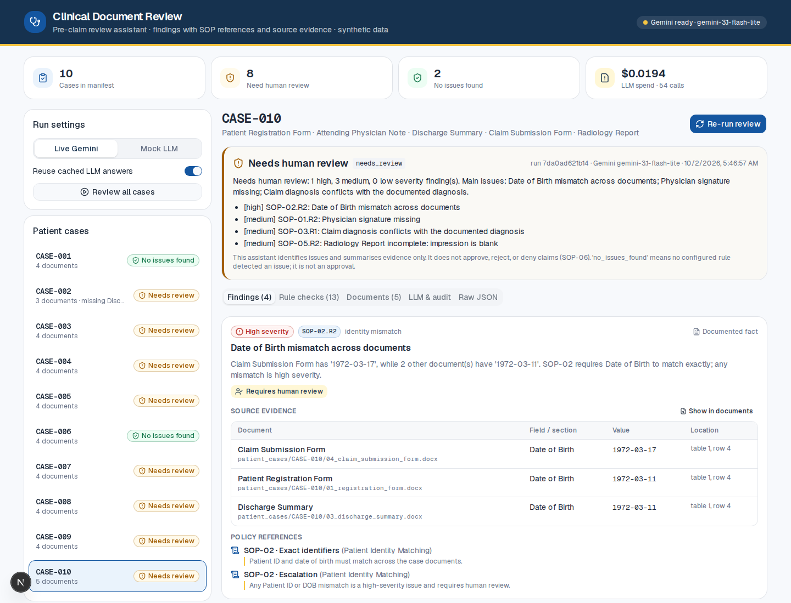
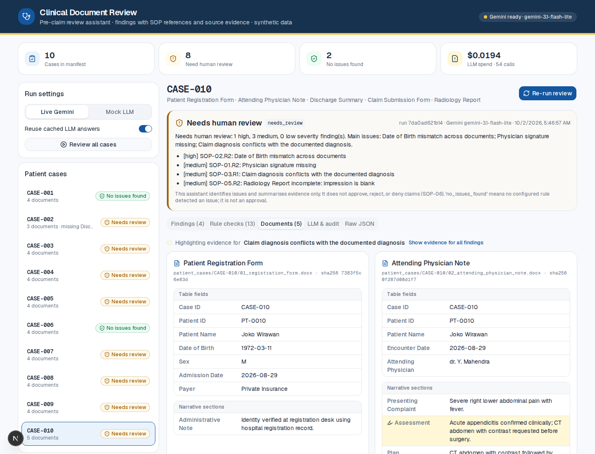
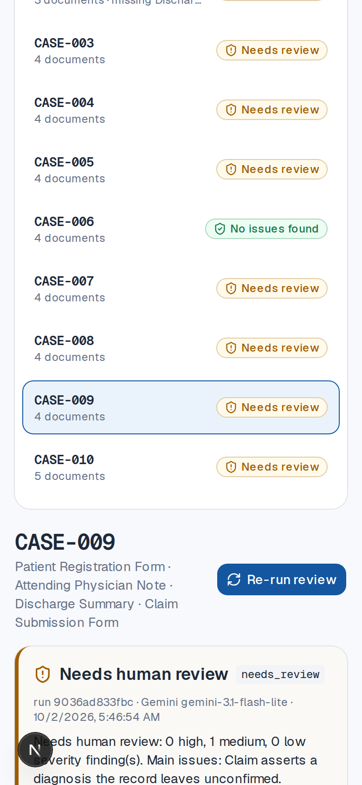

# Clinical Document Review Assistant

An API service that reviews one synthetic patient case at a time against the hospital SOPs and
returns structured JSON: a case status, every finding with its SOP reference and the exact
document fields used as evidence, uncertainties, and the reasons a human must review the case.
It never approves, rejects or denies a claim (SOP-06).

- **Deterministic rules** for everything an SOP defines exactly: required documents and fields
  (SOP-01), identity (SOP-02), dates (SOP-04), procedure support (SOP-05).
- **One guarded LLM step** (Google Gemini `gemini-3.1-flash-lite`) for SOP-03 diagnosis
  consistency, where clinical wording matters ("T2DM, uncomplicated" vs "Type 2 diabetes mellitus
  without complications"). Its output is schema-validated and quote-verified, and any doubt
  becomes `needs_review`.
- **Mock LLM fallback** with the same interface, so everything runs without an API key.
- **Reviewer UI** (extra) to run cases and inspect findings, evidence and audit data.

| Document | Contents |
|---|---|
| [`docs/requirement-analysis.md`](docs/requirement-analysis.md) | Requirements, ambiguities (RQ-xx), assumptions (A-xx), scope, success criteria |
| [`docs/architecture.md`](docs/architecture.md) | Design, Mermaid diagrams, AI vs deterministic, reliability/safety/cost, production roadmap |
| [`docs/cost-summary.md`](docs/cost-summary.md) | Every LLM call from the live runs, per-case and overall totals, pricing source (generated) |
| [`docs/evidence/`](docs/evidence) | Eval report, raw call log, audit log, and the live JSON result for all 10 cases |
| [`docs/ui-design-tokens.md`](docs/ui-design-tokens.md) | UI colour tokens, usage rules, WCAG contrast notes |

## Results (live Gemini)

All 10 cases ran through the API (and again through the UI) against Gemini.
`eval/run_eval.py` checks the results against a gold set I wrote (`eval/expected.yaml`):

| Metric | Result |
|---|---|
| Case-status accuracy | 10/10 |
| High-severity escalation recall | 4/4 |
| Finding precision / recall | 1.00 / 1.00 (11 findings) |
| False positives on clean cases (CASE-001, CASE-006 equivalence trap) | 0 |
| Evidence validity (every cited field/value exists in the document) | 29/29 |
| SOP-03 verdict stability (5 runs per LLM case) | 5/5 for all 6 cases |
| Mock vs live SOP-03 agreement | 6/6 |
| Cost of one full pass over 10 cases | USD 0.002774 (6 LLM calls; 4 cases need none) |

| Case | Status | Findings |
|---|---|---|
| CASE-001 | no_issues_found | none |
| CASE-002 | needs_review | SOP-01.R1 Discharge Summary missing |
| CASE-003 | needs_review | SOP-01.R2 claim Primary Diagnosis blank (not inferred) |
| CASE-004 | needs_review | SOP-02.R1 Patient ID PT-0044 vs PT-0004 (high); SOP-03.R3 low observation: "suspected" in note, confirmed at discharge |
| CASE-005 | needs_review | SOP-03.R1 claim "Acute bronchitis" vs record "Pneumonia" |
| CASE-006 | no_issues_found | none ("T2DM, uncomplicated" judged equivalent) |
| CASE-007 | needs_review | SOP-04.R1 discharge 2026-08-21 before admission 2026-08-22 (high) |
| CASE-008 | needs_review | SOP-05.R1 colonoscopy claimed, no Endoscopy Report (high) |
| CASE-009 | needs_review | SOP-03.R2 claim "Acute appendicitis" while record says not confirmed |
| CASE-010 | needs_review | SOP-02.R2 DOB mismatch (high); SOP-01.R2 not signed; SOP-03.R1 gastroenteritis vs appendicitis; SOP-05.R2 radiology Impression blank |

## Quick Start

### Option A: Docker (API + UI)

```bash
cp .env.example .env          # optional: add GEMINI_API_KEY; without it the mock is used
docker compose up --build
```

- API: <http://localhost:8741> (interactive docs at <http://localhost:8741/docs>)
- UI: <http://localhost:3417>

### Option B: Local

Requires Python 3.11+ and Node 20+.

```bash
# API
python3 -m venv .venv && source .venv/bin/activate
pip install -r requirements.txt && pip install -e .
cp .env.example .env          # optional: add GEMINI_API_KEY
uvicorn review_assistant.api:app --port 8741

# UI (second terminal)
cd ui && npm install && npm run dev      # http://localhost:3417, proxies /api/* to API_BASE_URL (default http://127.0.0.1:8741)
```

### Run the supplied cases through the API

```bash
curl -s localhost:8741/cases | jq '.[].case_id'
curl -s -X POST "localhost:8741/cases/CASE-010/review" | jq '{status, human_review_reasons}'
curl -s -X POST "localhost:8741/cases/CASE-006/review?llm_mode=mock" | jq '.status'
curl -s -X POST "localhost:8741/reviews/batch?llm_mode=live&use_cache=false"     # all 10 cases

python scripts/run_cases_via_api.py --llm-mode live --run-label my-run --out-dir outputs
```

Query parameters on `POST /cases/{id}/review`: `llm_mode=live|mock` (default: live if a key is
set, otherwise mock), `use_cache=true|false`, `run_label` (tags rows in the call log).

### CLI helper

```bash
review-assistant review CASE-004            # or: python -m review_assistant.cli review --all --llm-mode mock
```

### Evaluation and cost summary

```bash
python eval/run_eval.py --llm-mode live --stability 4 --compare-mock --report docs/evidence/eval-report.md
python scripts/generate_cost_summary.py --log var/logs/llm_calls.jsonl --out docs/cost-summary.md
```

The eval exits non-zero if a hard gate fails: status accuracy, high-severity recall, clean-case
false positives, or evidence validity. The committed cost summary was generated from
`docs/evidence/llm_calls.jsonl` (54 rows: canonical pass, cache pass, eval, stability, UI run,
mock comparison).

## Configuration

| Variable | Default | Notes |
|---|---|---|
| `GEMINI_API_KEY` | (empty) | Only in `.env` (gitignored) or the environment. Empty means mock mode. |
| `LLM_MODE` | `live` | `live` falls back to `mock` when no key is set. Per-request override via `llm_mode`. |
| `GEMINI_MODEL` | `gemini-3.1-flash-lite` | Pricing table in `src/review_assistant/config.py` |
| `GEMINI_THINKING_LEVEL` | `minimal` | |
| `LLM_TIMEOUT_S` / `LLM_MAX_RETRIES` | `10` / `3` | Per attempt; backoff 1, 2, 4 s |
| `LLM_MIN_CONFIDENCE` | `0.7` | Lower-confidence verdicts escalate instead of deciding |
| `LLM_CACHE_ENABLED` | `true` | File cache under `var/cache/llm/` |
| `DATA_DIR` / `VAR_DIR` | `./data` / `./var` | Case bundle location; logs, cache, stored reviews |
| `API_BASE_URL` (UI) | `http://127.0.0.1:8741` | Where the UI server proxies `/api/*` |

Logs (file-based, under `var/logs/`): `app.log` (JSON events by `run_id`), `llm_calls.jsonl`
(one row per LLM call, no document text), `audit.jsonl` (inputs hashes, rule/prompt/model/SOP
versions, outcome). Each result is also stored at `var/reviews/<case>/<run_id>.json`.

## Project Layout

```text
src/review_assistant/
  api.py          FastAPI endpoints
  pipeline.py     orchestrator + SOP-06 decision assembly, audit and event logging
  ingestion.py    manifest loader, python-docx parser with provenance
  rules.py        deterministic SOP-01/02/04/05 rules
  diagnosis.py    SOP-03 LLM step: prompt, cache, retries, guards, verdict -> findings
  llm/            LLMClient interface, Gemini client, mock client, call log/cache/cost
  sops.py         SOP registry with content-hash versions
  models.py       Pydantic contract (ReviewResult, Finding, Evidence, ...)
  normalize.py    dates, IDs, names, blanks, uncertainty markers
  cli.py          CLI helper
eval/             gold set + evaluation script
scripts/          run all cases via API; generate docs/cost-summary.md
data/             candidate package (synthetic cases, SOPs, manifest), unchanged
ui/               Next.js + Tailwind + shadcn/ui reviewer UI
docs/             deliverables, evidence, screenshots
```

## Key Decisions and Trade-offs

| Decision | Trade-off |
|---|---|
| **LLM only for SOP-03**; all other rules deterministic | Exact policies stay exact, auditable and free. An LLM over everything would be more flexible on messy documents but harder to trust and test. |
| **LLM never sets the status** | Status is computed from finding flags. Model output is enum-only, schema-validated and quote-verified. Lower recall on edge cases the enum cannot express, in exchange for predictable behaviour. |
| **Failure means `needs_review`, not a mock fallback** | Safer than silently swapping in a weaker comparator mid-run, at the cost of extra reviews during provider outages. The mock can still be selected explicitly. |
| **Skip the LLM when it adds nothing** (blank claim diagnosis, exact match) | 4 of 10 cases make no call. An exact string match with no uncertainty wording is treated as consistent without a model check. |
| **No RAG, no vector DB** | 7 short SOPs go verbatim into the prompt or map to rules. Retrieval would add a failure mode without improving recall. The scale-up path is in the architecture doc. |
| **Plain Python, no LangChain/LangGraph** | A fixed one-call DAG. Explicit code makes retries and guards visible. LangGraph would pay off for multi-step agentic extraction or human-in-the-loop resume. |
| **Case-ID API over bundled data** | Meets "accept or identify one patient case". An upload endpoint and OCR are listed as production work. |
| **Two statuses, three severities, severity only "high" where an SOP says so** | Traceable to policy text. Operations may want diagnosis conflicts ranked higher; that is a one-line change (A-06). |
| **File-based JSONL logs** | Zero infrastructure and easy to inspect. Production would use a log pipeline plus Postgres. |
| **Gold set written by me** | No labels are supplied. The eval measures agreement with documented assumptions, not clinical truth. |
| **`gemini-3.1-flash-lite` with minimal thinking** | Cheapest GA model with native JSON schema. Accurate and stable on this task in the eval. Model is configurable and versioned in the audit record. |

Assumptions about contested cases (A-02 "Not signed" = missing field, A-03 discharge summary is
the final diagnosis, A-04 blank Impression = incomplete report, A-05 identity compared only where
present) are argued in `docs/requirement-analysis.md`.

**Observed in testing:** Gemini requests sometimes hang (25–42% of calls needed a retry across
two full runs). A 10 s per-attempt timeout with 3 retries absorbed it with 0 failures in the
final run. In an earlier configuration, one call exhausted its retries and the case correctly
fell back to `needs_review`.

## Screenshots

| Findings with evidence and SOP references | Evidence highlighted in the source documents | Mobile |
|---|---|---|
|  |  |  |

## Security Notes

- No secrets in the repo: `.env` is gitignored and `.dockerignore`d; `.env.example` holds a placeholder.
- Only diagnosis/assessment text is sent to the LLM. Names, Patient IDs and DOBs never are.
- All patient data in `data/` is synthetic and comes from the candidate package.
