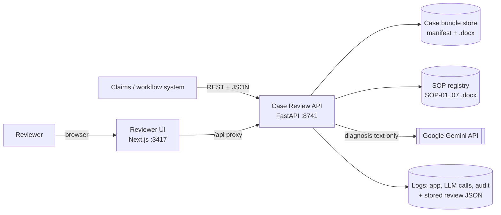
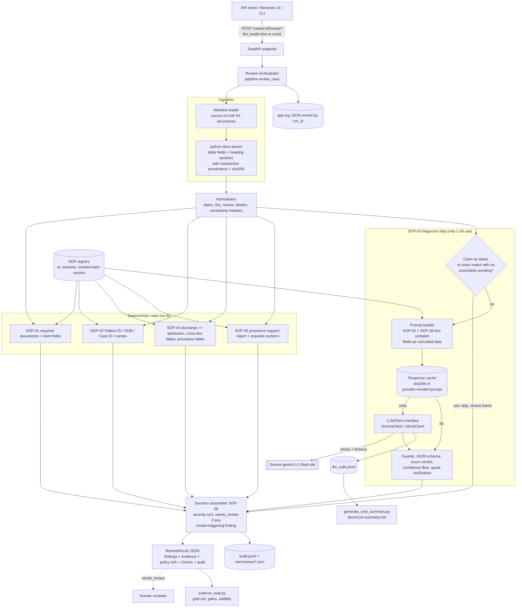

# Architecture

## 1. System Context and Boundaries



- **Inputs:** a case ID. The manifest (`data/case_manifest.csv`) decides which documents belong to
  the case. SOPs are loaded from `data/policies_sops/`.
- **Output:** a `ReviewResult` JSON with status, findings, checks, evidence, policy references,
  uncertainties, LLM usage and an audit record.
- **Trust boundaries:** (1) document text is untrusted input: it is parsed, never executed, and
  marked as data in prompts; (2) the LLM provider is an external processor that receives only the
  diagnosis/assessment strings; (3) the browser talks only to the UI server, which proxies to the
  API, so the API does not need to be exposed publicly.
- **Downstream:** reviewers act on `needs_review`. Systems may route on `status` and
  `findings[].severity`, but must not treat `no_issues_found` as an approval.

## 2. Architecture Diagram (Required)



## 3. API Contract

| Method & path | Purpose |
|---|---|
| `GET /health` | Version, default LLM mode, whether Gemini is configured, rule set and prompt versions |
| `GET /cases` | Cases from the manifest with document types, missing core documents, latest review status |
| `GET /cases/{case_id}` | Parsed documents (fields and sections with locations and hashes) |
| `POST /cases/{case_id}/review` | Run a review. Query: `llm_mode=live\|mock` (optional), `use_cache=true\|false`, `run_label` |
| `GET /cases/{case_id}/reviews/latest` | Last stored result |
| `POST /reviews/batch` | Review every case (same query parameters) |
| `GET /policies` | SOP registry with versions |
| `GET /llm-calls` | Recent call-log rows and totals |

Errors: `404` for an unknown case ID; `400` when `llm_mode=live` is requested without a key;
`422` for invalid parameters. LLM failures never cause a 5xx. They become a finding.

Response (abridged; full schema at `/docs`):

```json
{
  "case_id": "CASE-010", "run_id": "7da0ad621b14", "status": "needs_review",
  "summary": "Needs human review: 1 high, 3 medium, 0 low severity finding(s). ...",
  "human_review_required": true,
  "human_review_reasons": ["[high] SOP-02.R2: Date of Birth mismatch across documents", "..."],
  "findings": [{
    "finding_id": "CASE-010-F01", "rule_id": "SOP-02.R2", "category": "identity_mismatch",
    "severity": "high", "title": "Date of Birth mismatch across documents",
    "description": "Claim Submission Form has '1972-03-17', while 2 other document(s) have '1972-03-11'. ...",
    "policy_refs": [{"sop_id": "SOP-02", "section": "Exact identifiers", "version": "sha256:…", "excerpt": "Patient ID and date of birth must match across the case documents."}],
    "evidence": [{"document_type": "Claim Submission Form", "file": "patient_cases/CASE-010/04_claim_submission_form.docx",
                  "field": "Date of Birth", "value": "1972-03-17", "location": "table 1, row 4", "note": null}],
    "basis": "documented_fact", "confidence": 1.0, "requires_human_review": true
  }],
  "checks": [{"rule_id": "SOP-04.R1", "outcome": "pass", "detail": "3 document(s) with both dates checked", "...": "..."}],
  "uncertainties": [],
  "llm_calls": [{"provider": "gemini", "model": "gemini-3.1-flash-lite", "input_tokens": 767, "output_tokens": 183,
                 "cost_usd": 0.000466, "latency_ms": 1527, "retries": 0, "cache_status": "miss", "status": "ok"}],
  "audit": {"rule_set_version": "rules-2026.10.1", "prompt_version": "sop03-diagnosis-v1", "sop_versions": {"SOP-01": "sha256:…"},
            "input_documents": [{"file": "…", "sha256": "…"}]},
  "decision_boundary": "This assistant identifies issues and summarises evidence only. ..."
}
```

Full live outputs for all 10 cases are in `docs/evidence/reviews/`.

## 4. Component Responsibilities and Processing Flow

| Component | Module | Responsibility | Failure behaviour |
|---|---|---|---|
| Manifest loader | `ingestion.py` | Lists the documents for a case. Files on disk but not in the manifest are ignored. | Unknown case leads to 404. A listed file that is missing or unparseable becomes a SOP-01 finding, not a crash. |
| DOCX parser | `ingestion.py` | Extracts table rows as fields and Heading-2 blocks as sections. Keeps empty sections (a blank Impression is evidence). Records the location and file sha256. | Per-file errors are isolated (see above). Parsing is cached by content hash. |
| SOP registry | `sops.py` | Loads SOP sections. Version = content hash. Builds `PolicyRef` with the verbatim excerpt. | A missing SOP section raises at startup/test time, not silently. |
| Normalisers | `normalize.py` | Dates (several formats), IDs, names (titles/punctuation), blanks, uncertainty markers. | Unparseable dates make the check `undetermined` and add an uncertainty. |
| Deterministic rules | `rules.py` | SOP-01, 02, 04, 05. Each returns findings and `CheckResult`s. | Pure functions; no I/O. |
| Diagnosis step | `diagnosis.py` | SOP-03 gate, prompt, cache, retries, guards, and mapping of the verdict to findings. | Any failure becomes a SOP-06.R1 `undetermined` finding, so the case is `needs_review`. |
| LLM clients | `llm/` | `GeminiClient` (structured output, temperature 0, minimal thinking, timeout) and `MockClient` (same prompt in, same schema out). | Transport errors raise `LLMError` and are retried by the caller. |
| Orchestrator / assembler | `pipeline.py` | Runs the steps, sorts by severity, numbers findings, sets the status, writes the audit record, stored JSON and events. | Idempotent per input: same documents + versions + cache give the same result. Every run gets a new `run_id`. |
| API | `api.py` | HTTP contract, validation, CORS for the UI. | Batch reviews isolate per-case failures. |

**Retries and timeouts.** Per-attempt timeout 10 s, up to 3 retries (backoff 1 s, 2 s, 4 s).
Invalid JSON or schema violations are retried the same way. Latency in the log is wall-clock time
for the whole logical call.

## 5. AI vs. Deterministic Decisions

| Check | Approach | Why |
|---|---|---|
| Required documents / claim fields (SOP-01) | Deterministic | An exact list. An LLM adds only risk. |
| Patient ID / DOB match (SOP-02) | Deterministic | Exact equality is the policy. Also keeps identifiers out of the LLM. |
| Name normalisation (SOP-02) | Deterministic | Case, punctuation and titles are enumerable. |
| Date order / procedure dates (SOP-04) | Deterministic | Arithmetic. |
| Procedure support and blank sections (SOP-05) | Deterministic | Lookup table from SOP-05. "Blank" is detectable. |
| **Diagnosis equivalence / conflict / uncertainty (SOP-03)** | **LLM, guarded** | Clinical language: abbreviations ("T2DM, uncomplicated"), different conditions ("Pneumonia" vs "Acute bronchitis"), hedging ("appendicitis not confirmed"). A synonym table does not scale; a small model handles it reliably. |
| Case status (SOP-06) | Deterministic | Status is a function of finding flags. Model free text never sets it. |

The LLM is also **skipped** when it cannot add information: a blank claim diagnosis (already a
SOP-01 finding; SOP-01 forbids inference) or an exact match with no uncertainty wording in the
discharge summary or physician note. Four of the ten cases need no LLM call.

**Why no RAG / vector DB.** The policy corpus is seven SOPs of a few paragraphs each. Each rule
maps to a known SOP section, and the SOP-03 step gets the full SOP-03 and SOP-06 text verbatim.
Retrieval would add a failure mode (missing the right clause) without adding recall. At hundreds
of versioned policies, I would add hybrid (BM25 + embedding) retrieval over section-level chunks
with policy version filters, and evaluate retrieval recall separately.

**Why no LangChain/LangGraph.** The flow is a fixed DAG with one model call. Plain Python keeps
the control flow, retries and guards visible and testable. LangGraph becomes worth it for
multi-step agentic work: tool-using extraction over messy documents, asking for missing
documents, or pausing for human input and resuming with checkpointed state.

## 6. Evidence, Uncertainty, and Human Review

- **Provenance.** Every extracted value carries `file`, `document_type`, field/section `name`,
  `location` (table row or section heading) and the file's `sha256`. Evidence rows are copied
  from those values, never generated. Missing documents cite the manifest rows.
- **Model output grounding.** The model must quote verbatim from the labelled fields it was
  given. Each quote is checked as a normalised substring of the cited field. If any quote fails,
  the verdict is discarded and the case is escalated ("Model evidence could not be verified",
  SOP-07 / SOP-06).
- **Fact vs hypothesis (SOP-07).** `basis` is `documented_fact` for rule findings and
  `model_judgment` for SOP-03 findings, which also carry the model's confidence.
- **Confidence.** Verdicts below `LLM_MIN_CONFIDENCE` (0.7) are not relied on and become an
  `undetermined` finding. An `insufficient_evidence` verdict escalates the same way.
- **Checks.** `checks[]` lists every rule evaluated with `pass / issue / undetermined /
  not_applicable`, so a reviewer can see what was verified, not only what failed.
- **Escalation.** `status = needs_review` if any finding has `requires_human_review`.
  `human_review_reasons` lists them as `[severity] rule_id: title`. `uncertainties[]` records
  context limits (for example, a missing discharge summary means the final diagnosis came from
  the physician note).
- **Severity policy.** `high` where an SOP says so; `medium` for other SOP-06 escalations; `low`
  informational (for example CASE-004's "suspected → confirmed" progression, A-03).

## 7. Reliability, Safety, Deployment, and Cost

**Schema validation and hallucination controls.** Provider-native JSON schema generated from the
Pydantic model; Pydantic validation; enum-only verdicts; confidence range check; quote
verification; the model never writes field values and never "corrects" a diagnosis.

**Prompt injection.** Field values are HTML-escaped inside `<field>` tags. The system prompt
declares them untrusted data. The model has no tools, and the output is a closed schema that
code interprets. The worst a successful injection can do is push the verdict toward a
conflict/uncertain finding (review) or "equivalent" on that one check. Identity, dates,
completeness and procedure rules cannot be influenced by the model. Production would add an
injection-pattern detector on inputs that forces review.

**Privacy.** Data minimisation: only diagnosis/assessment strings go to the provider. Logs store
counts and request hashes, not text. Keys are read from the environment (`.env` is gitignored;
`.env.example` has a placeholder). Production: a zero-data-retention or in-region endpoint
(Vertex AI in an Indonesian/ASEAN region with a DPA), RBAC on the API, encryption at rest for
stored reviews, and log retention limits.

**Fallbacks.** No key gives mock mode automatically (`/health` shows it, the UI disables "Live").
A runtime provider failure is **not** silently replaced by the mock: the SOP-03 check becomes
`undetermined` and the case goes to review, because quietly switching to a weaker comparator
would hide a degraded decision. `llm_mode=mock` can be chosen explicitly per request.

**Observed provider reliability.** During development (first full run, 15 s timeout, 2 retries),
15 of 36 Gemini calls needed a retry, and 1 call failed on all 3 attempts. That run correctly
produced `needs_review` (an SOP-06.R1 finding) for CASE-009 instead of a guess. Successful
attempts take 1.5–3 s, so hangs are stuck requests, not slow ones. With a 10 s per-attempt
timeout and 3 retries, the final run had 9 of 36 calls retried and 0 failures. Production: alert
on the retry rate, add a secondary region/provider, and use a circuit breaker.

**Observability.** `var/logs/app.log` holds JSON events (`review_started`,
`review_completed` with status, rule IDs, cost) keyed by `run_id`. `llm_calls.jsonl` has one row
per call. `audit.jsonl` has case ID, input document hashes, rule set / prompt / model / SOP
versions, status and finding IDs, with `human_review_outcome` reserved. Full outputs are kept
under `var/reviews/<case>/<run_id>.json`. Production: ship these to a log pipeline (OpenTelemetry
traces per `run_id`), with dashboards for escalation rate by rule, LLM error rate, p95 latency
and cost per case.

**Model selection.** `gemini-3.1-flash-lite` (GA, USD 0.25 / 1.50 per 1M tokens, native JSON
schema, minimal thinking). The task is a narrow three-string comparison, and the eval shows
5/5 stability and 100% agreement with the gold set, so a larger model is not justified. The model
name is configuration, and the prompt version and model are in every audit record, so a switch
can be re-evaluated with `eval/run_eval.py`.

**Caching and cost drivers.** The response cache key is
sha256(provider, model, prompt version, system prompt, user prompt). Hits cost USD 0 and are
logged as `hit`. The main cost driver is the fixed ~700-token system prompt. One pass over the 10
cases costs USD 0.002774 (6 calls). See `docs/cost-summary.md`.

**Deployment.** `docker compose up --build` starts the API (Python 3.12-slim, non-root,
healthcheck) and the UI (Next.js standalone). The `.env` file is injected at runtime and never
baked into the image. Review state is kept in a named volume.

### What I would do in production (deliberately not built)

| Area | Production design | Why not now |
|---|---|---|
| Ingestion | Upload endpoint and object storage. Format detection; OCR/layout models for scans; LLM-assisted extraction **with** span-level provenance and deterministic validation. | The supplied documents are clean `.docx` templates. |
| Terminology | Map diagnoses to ICD-10/SNOMED via a terminology service before the LLM; LLM only for unresolved pairs. | Would be over-engineering for 10 cases. |
| Policies | Versioned policy store, hybrid retrieval, policy-change re-evaluation. | 7 short SOPs fit in a prompt. |
| Human loop | Reviewer decision capture, override reasons, a feedback dataset, an online override-rate metric. | Needs a workflow owner. |
| Quality | Clinician-labelled set, adversarial cases (injection, near-miss IDs, OCR noise), shadow mode, drift monitoring, regression gate in CI. | Time box. The eval harness is the seed. |
| Security | AuthN/Z, tenant isolation, encryption, PHI-safe logging policy, DPA'd model endpoint, secret manager. | Synthetic data, single-user demo. |
| Scale | Async job queue for batch reviews, idempotency keys, Postgres for reviews/audit, provider batch API for back-office runs (50% cheaper). | Synchronous calls finish in seconds here. |
